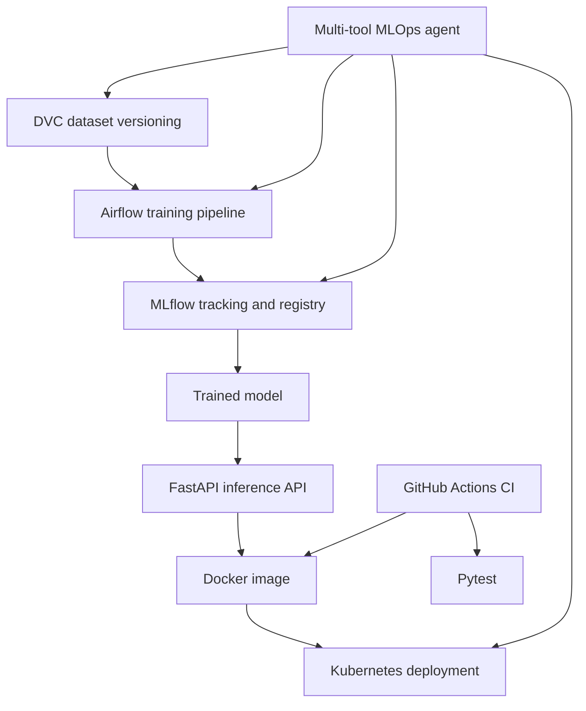

# MLOps AI Agent

A production-style MLOps project that combines DVC, MLflow, Apache Airflow, FastAPI, Docker, Kubernetes, GitHub Actions, and a safe multi-tool AI agent.

The project trains a breast-cancer classifier and lets an agent inspect datasets, ML experiments, Airflow pipeline status, and Kubernetes deployment health through natural-language requests.

## Project goals

- Version and inspect datasets with DVC
- Track and compare ML experiments with MLflow
- Orchestrate model training with Apache Airflow
- Serve predictions through a FastAPI inference API
- Package the API in Docker
- Deploy two API replicas to Kubernetes
- Route natural-language requests to real MLOps tools
- Require explicit confirmation before state-changing operations
- Automatically test and build the project with GitHub Actions

## Architecture



## Setup

This project was developed on Ubuntu WSL with Python 3.12.

```bash
git clone https://github.com/zarnab123/assignment-03-mlops-agent-zarnab.git
cd assignment-03-mlops-agent-zarnab
python3 -m venv .venv
source .venv/bin/activate
pip install -r requirements-api.txt
pip install mlflow pytest dvc scikit-learn pandas apache-airflow
```

## DVC data management

The project tracks the breast-cancer dataset with DVC and records dataset provenance in MLflow.

```bash
dvc status
dvc data status
dvc diff dataset-v1 dataset-v2
```

DVC tools can list datasets, inspect DVC hashes and Git commits, compare versions, detect changes, and explain reproduction steps.

## MLflow experiment tracking

Start MLflow:

```bash
mlflow server --backend-store-uri sqlite:///mlflow.db --host 127.0.0.1 --port 5000
```

Then open:

```text
http://127.0.0.1:5000
```

Training runs log parameters, Accuracy, F1 score, dataset version, DVC hash, Git commit, model signature, and artifacts. The registered model is `BreastCancerClassifier`.

## Airflow training pipeline

Start Airflow:

```bash
export AIRFLOW_HOME="$HOME/assignment-03-mlops-zarnab/airflow"
export AIRFLOW__CORE__DAGS_FOLDER="$HOME/assignment-03-mlops-zarnab/dags"
export AIRFLOW__CORE__LOAD_EXAMPLES=False
airflow standalone
```

Open `http://127.0.0.1:8080` and trigger DAG `mlops_training_pipeline`.

Pipeline stages:

1. Dataset validation
2. Preprocessing
3. Model training
4. MLflow evaluation and logging
5. Quality gate

Failed validation or quality checks prevent an inappropriate downstream result.

## FastAPI inference API

Export the model and start the service:

```bash
python training/export_model.py
uvicorn api.main:app --host 127.0.0.1 --port 8000
```

Health check:

```bash
curl http://127.0.0.1:8000/health
```

API endpoints:

- `GET /`
- `GET /health`
- `POST /predict`
- `GET /docs`

## Docker

```bash
docker build -t mlops-agent-api:1.0.0 .
docker run -d --name mlops-agent-api -p 8001:8000 mlops-agent-api:1.0.0
curl http://127.0.0.1:8001/health
```

The Docker build exports the model inside the image, so CI can build it without depending on local DVC storage.

## Kubernetes

Deploy to Docker Desktop Kubernetes:

```bash
kubectl apply -f kubernetes/app.yaml
kubectl rollout status deployment/mlops-agent-api -n mlops-agent --timeout=120s
kubectl get all -n mlops-agent
```

The deployment includes:

- Two API replicas
- ClusterIP Service
- ConfigMap
- Readiness and liveness probes
- CPU and memory limits

Test the Service:

```bash
kubectl port-forward -n mlops-agent service/mlops-agent-api 8081:80
curl http://127.0.0.1:8081/health
```

## Multi-tool MLOps agent

The agent routes natural-language requests to real DVC, MLflow, Airflow, and Kubernetes tools.

```bash
python -c "from agent.orchestrator import handle_request; print(handle_request('Show my DVC datasets'))"
python -c "from agent.orchestrator import handle_request; print(handle_request('Which MLflow run is best?'))"
python -c "from agent.orchestrator import handle_request; print(handle_request('What is the latest Airflow pipeline status?'))"
python -c "from agent.orchestrator import handle_request; print(handle_request('Show Kubernetes deployment status'))"
```

State-changing actions are protected. For example, scaling Kubernetes or triggering an Airflow pipeline first returns `confirmation_required`; the action only happens with `confirmed=True`.

## Tests and CI

Run tests:

```bash
python -m pytest -q
```

GitHub Actions runs automatically on each push and pull request. It installs dependencies, runs the tests, and builds the Docker image. The CI workflow has passed successfully.

## Evidence and limitations

`screenshots/` contains MLflow and Airflow evidence. Docker, Kubernetes, agent, testing, and GitHub Actions were also verified during the demonstration.

Current limitations: the DVC remote and Kubernetes cluster are local coursework infrastructure, and agent routing is rule-based. Future work includes cloud storage, model-drift monitoring, LLM-based tool selection, secrets management, and container registry publishing.

## Author

Zarnab Javed  
GitHub: [zarnab123](https://github.com/zarnab123)
