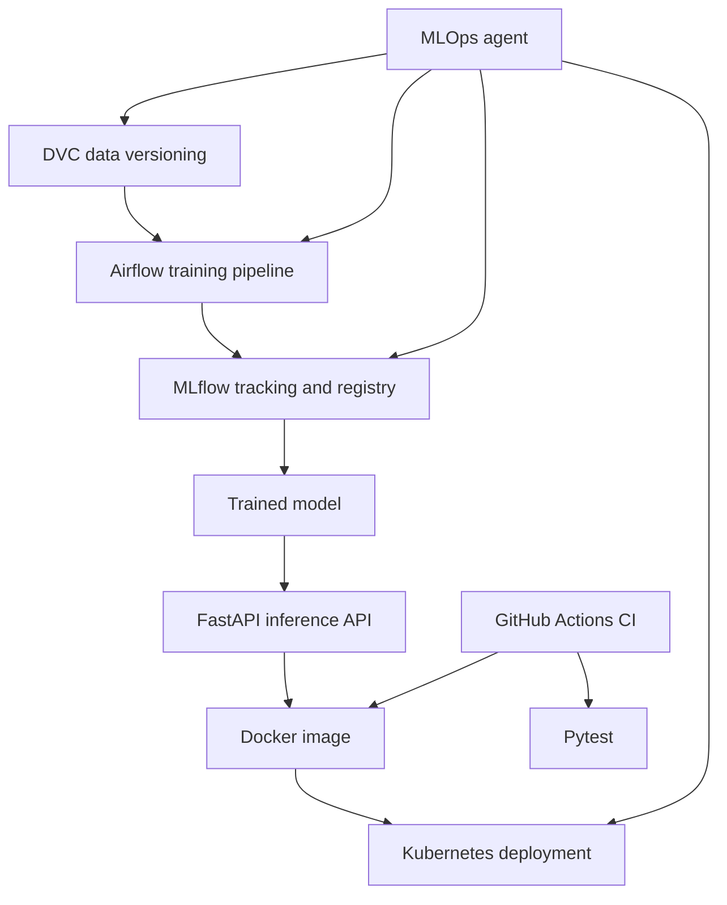

# MLOps AI Agent

A production-style MLOps project that combines DVC, MLflow, Apache Airflow, FastAPI, Docker, Kubernetes, GitHub Actions, and a safe multi-tool MLOps agent.

The project trains a breast-cancer classifier and lets a user inspect datasets, ML experiments, Airflow pipeline status, and Kubernetes deployment health using natural-language requests.

## Project goals

- Version and inspect datasets with DVC
- Track experiments, metrics, artifacts, and models with MLflow
- Orchestrate training with Apache Airflow
- Serve predictions through FastAPI
- Package the service in Docker
- Deploy two API replicas to Kubernetes
- Route user requests to real MLOps tools
- Require confirmation before state-changing actions
- Test and build automatically with GitHub Actions

## Architecture



## Project structure

```text
agent/                 Multi-tool agent and DVC, MLflow, Airflow, Kubernetes tools
api/main.py            FastAPI inference service
dags/training_pipeline.py  Airflow training DAG
training/              Data generation, training, and model export scripts
kubernetes/app.yaml    Namespace, ConfigMap, Deployment, and Service
tests/                 Automated pytest tests
screenshots/           MLflow and Airflow evidence
.github/workflows/     GitHub Actions CI workflow
```

## Local setup

Developed and demonstrated on Ubuntu WSL with Python 3.12.

```bash
git clone https://github.com/zarnab123/assignment-03-mlops-agent-zarnab.git
cd assignment-03-mlops-agent-zarnab

python3 -m venv .venv
source .venv/bin/activate

pip install -r requirements-api.txt
pip install mlflow pytest dvc scikit-learn pandas apache-airflow
```

## DVC data management

DVC tracks the breast-cancer dataset, its version, hash, and reproducible reference.

```bash
dvc status
dvc data status
dvc diff dataset-v1 dataset-v2
```

The agent can list datasets, inspect provenance, compare versions, detect data changes, and explain how to reproduce a previous version.

## MLflow experiment tracking

Start the MLflow server:

```bash
mlflow server --backend-store-uri sqlite:///mlflow.db --host 127.0.0.1 --port 5000
```

Open:

```text
http://127.0.0.1:5000
```

MLflow records Logistic Regression parameters, Accuracy, F1 score, dataset version, DVC hash, Git commit, model signature, and artifacts.

The best recorded candidate was:

```text
Run: LogisticRegression_C_1.0
Accuracy: 0.97
F1 score: 0.9739130434782609
Model registry: BreastCancerClassifier
```

The agent treats this as a candidate, not automatically as a production-ready model.

## Airflow pipeline

Start Airflow:

```bash
export AIRFLOW_HOME="$HOME/assignment-03-mlops-zarnab/airflow"
export AIRFLOW__CORE__DAGS_FOLDER="$HOME/assignment-03-mlops-zarnab/dags"
export AIRFLOW__CORE__LOAD_EXAMPLES=False
airflow standalone
```

Open:

```text
http://127.0.0.1:8080
```

The DAG is named `mlops_training_pipeline` and contains:

1. Dataset validation
2. Preprocessing
3. Model training
4. MLflow evaluation and logging
5. Quality gate

Validation and training use retries. A failed validation or quality gate prevents an inappropriate downstream result.

## FastAPI inference API

Export the trained model and start the API:

```bash
python training/export_model.py
uvicorn api.main:app --host 127.0.0.1 --port 8000
```

Health check:

```bash
curl http://127.0.0.1:8000/health
```

Expected result:

```json
{"status":"healthy","model":"BreastCancerClassifier","version":"1.0.0"}
```

Endpoints:

- `GET /`
- `GET /health`
- `POST /predict`
- `GET /docs`

## Docker

Build and run the container:

```bash
docker build -t mlops-agent-api:1.0.0 .
docker run -d --name mlops-agent-api -p 8001:8000 mlops-agent-api:1.0.0
curl http://127.0.0.1:8001/health
```

The Docker build exports the model inside the image, so it can build successfully in GitHub Actions without depending on local DVC storage.

## Kubernetes deployment

Deploy the API to Docker Desktop Kubernetes:

```bash
kubectl apply -f kubernetes/app.yaml
kubectl rollout status deployment/mlops-agent-api -n mlops-agent --timeout=120s
kubectl get all -n mlops-agent
```

The Kubernetes configuration includes:

- Namespace: `mlops-agent`
- Deployment with two replicas
- ClusterIP Service
- ConfigMap for non-sensitive application configuration
- Readiness and liveness probes on `/health`
- CPU and memory resource requests and limits

Test the Service locally:

```bash
kubectl port-forward -n mlops-agent service/mlops-agent-api 8081:80
curl http://127.0.0.1:8081/health
```

## Multi-tool MLOps agent

The agent is implemented in `agent/orchestrator.py`. It routes requests to real DVC, MLflow, Airflow, and Kubernetes tools.

```bash
python -c "from agent.orchestrator import handle_request; print(handle_request('Show my DVC datasets'))"

python -c "from agent.orchestrator import handle_request; print(handle_request('Which MLflow run is best?'))"

python -c "from agent.orchestrator import handle_request; print(handle_request('What is the latest Airflow pipeline status?'))"

python -c "from agent.orchestrator import handle_request; print(handle_request('Show Kubernetes deployment status'))"
```

State-changing actions are protected. Triggering the Airflow pipeline or scaling Kubernetes first returns `confirmation_required`. The operation only runs with explicit `confirmed=True`.

## Tests and CI

Run tests through the active virtual environment:

```bash
python -m pytest -q
```

The project currently has nine passing automated tests for agent routing and safety behavior.

GitHub Actions runs on every push and pull request. CI installs dependencies, runs the test suite, and builds the Docker image. The workflow completed successfully.

## Evidence

The `screenshots/` directory contains evidence for:

- MLflow experiment runs
- MLflow model registry
- Successful Airflow DAG execution
- Airflow training task logs

Docker API health, Kubernetes deployment health, agent conversations, passing tests, and GitHub Actions CI were also verified during the project demonstration.

## Limitations and future improvements

- The DVC remote is local coursework storage; production should use cloud object storage.
- The Kubernetes cluster runs locally through Docker Desktop.
- Agent routing is deterministic and rule-based.
- Automatic model promotion is intentionally not enabled.

Future work can add cloud DVC storage, drift monitoring, LLM-based tool selection, secrets management, container registry publishing, alerts, and deployment rollback.

## Author

Zarnab Javed  
GitHub: [zarnab123](https://github.com/zarnab123)
