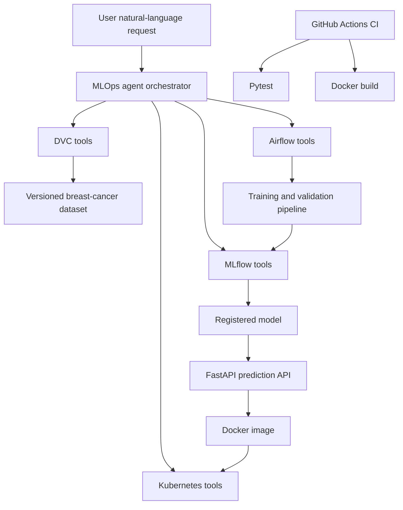

**Student:** Zarnab Javed  
**Repository:** https://github.com/zarnab123/assignment-03-mlops-agent-zarnab  
**Course:** MLOps and Production AI Engineering  
**Assignment:** Building a Production-Ready MLOps AI Agent  

## 1. Project objective

This project implements an operational MLOps agent for a breast-cancer classification system. Instead of giving answers from static text, the agent calls real DVC, MLflow, Airflow, and Kubernetes tools to collect operational evidence.

The system supports the following ML-engineering activities:

- Identify the dataset version and DVC provenance used for training
- Inspect MLflow experiments, metrics, artifacts, and model registry information
- Check recent Apache Airflow training-pipeline status
- Inspect Kubernetes deployment, Pods, Service, endpoints, and logs
- Run only approved state-changing operations after explicit confirmation
- Serve model predictions through a containerized FastAPI application

## 2. System architecture



## 3. Major components

| Component | Implementation |
|---|---|
| DVC | Tracks the breast-cancer dataset and supports version inspection, provenance, comparison, change detection, and reproduction guidance |
| MLflow | Records experiments, parameters, metrics, dataset metadata, model signature, artifacts, and registry information |
| Airflow | Runs a real training DAG with validation, preprocessing, training, MLflow evaluation, and quality gate |
| FastAPI | Provides inference endpoints: `/`, `/health`, `/predict`, and `/docs` |
| Docker | Packages the API and reproducibly exports the model during image build |
| Kubernetes | Runs two FastAPI replicas behind a ClusterIP Service |
| Agent | Routes user requests to the corresponding MLOps tool modules |
| Tests | Uses pytest tests for routing and safety behavior |
| CI | GitHub Actions runs tests and Docker build on every push and pull request |

## 4. DVC data management

The project uses DVC to version the breast-cancer dataset. The agent does not directly edit or delete DVC data.

Implemented DVC tools:

| Tool | Purpose |
|---|---|
| `list_datasets` | Lists tracked dataset files and DVC metadata |
| `get_dataset_provenance` | Retrieves dataset version, DVC hash, Git commit, and size |
| `compare_dataset_versions` | Compares two Git/DVC dataset versions |
| `detect_data_changes` | Checks whether tracked data has changed |
| `reproduction_guidance` | Explains safe commands for restoring a version |

The training run recorded the following provenance:

```text
Dataset: breast_cancer.csv
Dataset version: v2
DVC hash: 84c48bb58aa13436e67a52bfa76d02da
Dataset size: 867263 bytes
```

Useful reproducibility commands:

```bash
dvc status
dvc data status
dvc diff dataset-v1 dataset-v2
dvc pull
dvc repro
```

## 5. MLflow experiment intelligence

The MLflow module uses MLflow Python APIs to inspect experiments and model registry data. It does not scrape the MLflow web interface.

Implemented MLflow tools:

| Tool | Purpose |
|---|---|
| `list_experiments` | Lists experiments in the tracking server |
| `list_recent_runs` | Retrieves recent runs with parameters and metrics |
| `get_best_run` | Selects the best run using a requested metric |
| `list_run_artifacts` | Lists artifacts stored for a run |
| `get_model_registry_info` | Inspects registered model versions and aliases |

The model was trained with Logistic Regression. The best recorded candidate was:

```text
Run name: LogisticRegression_C_1.0
Status: FINISHED
Accuracy: 0.97
F1 score: 0.9739130434782609
Model registry: BreastCancerClassifier
```

The agent correctly treats this run as the best recorded **candidate** for F1 score only. It does not automatically declare it production-ready because production suitability also depends on data freshness, quality policy, bias checks, deployment health, and monitoring.

## 6. Apache Airflow workflow

The Airflow DAG is named:

```text
mlops_training_pipeline
```

The workflow contains these stages:

1. `validate_dataset`
2. `preprocess_data`
3. `train_model`
4. `evaluate_and_log`
5. `quality_gate`

The DAG validates required columns and data volume before training. It includes retry behavior for validation and training tasks. The quality gate checks evaluation results and blocks an inappropriate downstream result if quality thresholds are not achieved.

Implemented Airflow tools:

| Tool | Purpose |
|---|---|
| `list_dags` | Lists available Airflow DAGs |
| `list_dag_runs` | Retrieves DAG run history |
| `get_latest_pipeline_status` | Returns latest run state and timestamps |
| `trigger_training_pipeline` | Triggers only the approved training DAG after confirmation |

A real manual DAG run completed successfully:

```text
DAG: mlops_training_pipeline
Latest state: success
Run count: 1
```

## 7. FastAPI inference API and Docker

The FastAPI application loads the exported `BreastCancerClassifier` model.

Endpoints:

| Endpoint | Purpose |
|---|---|
| `GET /` | Service information |
| `GET /health` | Application and model health |
| `POST /predict` | Classifies 30 numerical breast-cancer features |
| `GET /docs` | Interactive Swagger documentation |

Verified health response:

```json
{
  "status": "healthy",
  "model": "BreastCancerClassifier",
  "version": "1.0.0"
}
```

The Docker image was built and run successfully:

```bash
docker build -t mlops-agent-api:1.0.0 .
docker run -d --name mlops-agent-api -p 8001:8000 mlops-agent-api:1.0.0
curl http://127.0.0.1:8001/health
```

The Dockerfile exports the model during image build. This makes the Docker build reproducible in CI without requiring local DVC storage to be available on the GitHub runner.

## 8. Kubernetes deployment and diagnostics

The application was deployed to Docker Desktop Kubernetes.

Configuration included:

- Namespace: `mlops-agent`
- Deployment: `mlops-agent-api`
- Desired replicas: `2`
- ClusterIP Service
- ConfigMap for non-sensitive version configuration
- Readiness probe: `GET /health`
- Liveness probe: `GET /health`
- CPU and memory resource requests and limits

Deployment verification:

```text
Deployment: mlops-agent-api
Desired replicas: 2
Available replicas: 2
Ready replicas: 2
Pods: 2 Running and Ready
Service: mlops-agent-api
Service type: ClusterIP
Service port: 80 -> targetPort 8000
```

The Kubernetes Service was tested through port forwarding:

```bash
kubectl port-forward -n mlops-agent service/mlops-agent-api 8081:80
curl http://127.0.0.1:8081/health
```

The health endpoint returned a successful healthy result.

Implemented Kubernetes tools:

| Tool | Purpose |
|---|---|
| `list_kubernetes_resources` | Inspects Deployment, Pods, ReplicaSet, and Service |
| `get_service_endpoints` | Retrieves ready endpoint IPs |
| `get_pod_logs` | Retrieves relevant Pod logs |
| `scale_inference_api` | Scales only the approved deployment after confirmation |

## 9. Safety controls and permissions

The agent does not allow unrestricted infrastructure commands.

| Operation | Safety rule |
|---|---|
| Read DVC, MLflow, Airflow, and Kubernetes information | Allowed through fixed safe tool functions |
| Trigger Airflow pipeline | Requires `confirmed=True` |
| Scale Kubernetes deployment | Requires `confirmed=True` |
| Kubernetes scope | Restricted to `mlops-agent` namespace |
| Kubernetes replica count | Validated between 1 and 5 |
| Model promotion | Not automatically performed |
| Secrets | API keys, tokens, credentials, and service-account tokens are not committed |

Example safety response for an unconfirmed request:

```text
User: Scale Kubernetes deployment to 3 replicas

Agent response:
confirmation_required
This will scale mlops-agent-api to 3 replicas.
Call again with confirmed=True only after user approval.
```

No cluster state was changed by this first request.

## 10. Five tested agent conversations

### Conversation 1: Dataset provenance

**User request**

```text
Show my DVC datasets
```

**Tool selected:** `list_datasets`

**Actual result**

```text
Dataset: breast_cancer.csv
DVC hash: 84c48bb58aa13436e67a52bfa76d02da
Size: 867263 bytes
```

### Conversation 2: Best MLflow candidate

**User request**

```text
Which MLflow run is best?
```

**Tool selected:** `get_best_run`

**Actual result**

```text
Run: LogisticRegression_C_1.0
Accuracy: 0.97
F1 score: 0.9739130434782609
Status: FINISHED
```

The response explains that the result is a candidate selected by F1 score and is not automatically production-ready.

### Conversation 3: Airflow pipeline status

**User request**

```text
What is the latest Airflow pipeline status?
```

**Tool selected:** `get_latest_pipeline_status`

**Actual result**

```text
DAG: mlops_training_pipeline
Latest run state: success
Run count: 1
```

### Conversation 4: Kubernetes deployment status

**User request**

```text
Show Kubernetes deployment status
```

**Tool selected:** `list_kubernetes_resources`

**Actual result**

```text
Deployment: mlops-agent-api
Desired replicas: 2
Available replicas: 2
Ready replicas: 2
Two Pods: Running and Ready
Service: ClusterIP on port 80
```

### Conversation 5: Safe scaling request

**User request**

```text
Scale Kubernetes deployment to 3 replicas
```

**Tool selected:** `scale_inference_api`

**Actual result**

```text
confirmation_required
This will scale mlops-agent-api to 3 replicas.
Call again with confirmed=True only after user approval.
```

This proves that the agent rejects an unauthorized modification and requires explicit user approval.

## 11. Failure investigations

### Failure investigation 1: Docker dependency error

**Observed error**

```text
ModuleNotFoundError: No module named 'pandas'
```

**Root cause**

The model-export script imports pandas, but pandas was initially missing from `requirements-api.txt`. Therefore, Docker failed while exporting the model during image build.

**Resolution**

`pandas` was added to `requirements-api.txt`.

**Verification**

```bash
docker build -t mlops-agent-api:1.0.2 .
```

The image build completed successfully.

### Failure investigation 2: Incorrect pytest interpreter

**Observed error**

```text
ModuleNotFoundError: No module named 'agent'
```

**Root cause**

The `pytest -q` command used the system pytest interpreter instead of the active project virtual environment. Therefore, the project package was unavailable during test collection.

**Resolution**

Tests were run through the active virtual environment:

```bash
python -m pytest -q
```

**Verification**

```text
9 passed in 2.54s
```

## 12. Automated tests and CI

The project includes nine automated pytest tests.

Test coverage includes:

- DVC request routing
- Dataset provenance routing
- MLflow best-run routing
- MLflow registry routing
- Airflow status routing
- Kubernetes deployment status routing
- Kubernetes endpoint routing
- Rejection of unconfirmed scaling
- Confirmed scaling request forwarding

GitHub Actions is implemented in:

```text
.github/workflows/ci.yml
```

The CI workflow:

1. Checks out the project
2. Sets up Python 3.12
3. Installs dependencies
4. Runs `python -m pytest -q`
5. Builds the Docker image

The GitHub Actions workflow completed successfully with a green status.

## 13. Evidence included in repository

The `screenshots/` directory contains evidence for:

- MLflow experiment runs
- MLflow model registry
- Successful Airflow DAG execution
- Airflow training task logs

The project was also demonstrated with evidence of:

- Docker API health response
- Kubernetes Pods and Service health
- Kubernetes port-forward health response
- Agent tool responses
- Passing pytest suite
- Successful GitHub Actions CI

## 14. Limitations and future improvements

Current limitations:

- The DVC remote is local coursework storage; production should use cloud object storage.
- Kubernetes runs through Docker Desktop rather than a managed cluster.
- Agent routing is deterministic and rule-based.
- Automatic model promotion is intentionally disabled.

Future improvements:

- Use cloud object storage as the DVC remote
- Add data-drift and model-drift monitoring
- Connect an LLM to the existing structured tools
- Add production secrets management
- Publish versioned Docker images to a container registry
- Add alerts for Airflow failures and unhealthy Pods
- Add canary deployment and rollback support

## 15. Conclusion

This project demonstrates a complete operational MLOps workflow. It integrates real DVC, MLflow, Apache Airflow, Docker, FastAPI, Kubernetes, automated testing, and GitHub Actions. The agent provides one controlled interface for inspecting infrastructure and ML workflow evidence while using explicit confirmation for state-changing operations.
